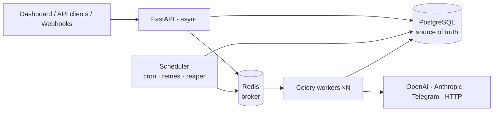

# NuroFlow

**Durable, AI-native workflow orchestration.** You declare a workflow as a DAG. NuroFlow schedules
it, retries it, survives crashes, and tells you on Telegram when it's done.

```text
lead.captured ─▶ AI qualify ─▶ store ─▶ AI summary ─▶ Telegram alert ─▶ ✔ run succeeded
```

> Built as a portfolio project to show production backend engineering: clean
> architecture, a crash-safe execution engine, a DB-driven scheduler, LLM integrations, and
> full CI/CD. It's inspired by Apache Airflow, but deliberately **not** a clone.

## Highlights

- **Crash-safe by design.** PostgreSQL is the source of truth, and Celery only carries IDs. Kill
  a worker or flush Redis mid-run, and the run still completes. ([ADR-0001](docs/adr/0001-postgres-as-source-of-truth.md))
- **HA scheduler with no leader election.** `FOR UPDATE SKIP LOCKED` plus idempotency keys
  mean each cron trigger fires exactly once across N replicas. ([ADR-0002](docs/adr/0002-db-driven-scheduler.md))
- **Durable retries.** Exponential backoff with jitter, visible per attempt, and they survive
  restarts. ([ADR-0003](docs/adr/0003-engine-managed-retries.md))
- **Safe by default.** Workflows are validated data, not user code, and templates run in Jinja's
  sandbox. Cycles, typos and reads from non-upstream tasks are rejected *before* saving.
  ([ADR-0004](docs/adr/0004-declarative-operators-no-arbitrary-code.md), [ENGINE.md](docs/ENGINE.md))
- **Exactly-once state transitions.** Compare-and-set claims, run-row locks and attempt
  fencing are proven by tests with concurrent workers and a real Celery worker.
- **AI tasks.** OpenAI and Anthropic sit behind one provider interface, with JSON-schema-validated
  output and token/cost tracking.
- **Serious auth.** JWT access tokens, rotating refresh tokens with theft detection, scoped
  API keys, RBAC, login throttling, and RFC 9457 error responses. ([AUTH.md](docs/AUTH.md))
- **Operable.** Structured logs, Prometheus metrics, live log tail over SSE, and a React dashboard.

## Architecture



Full design: **[docs/ARCHITECTURE.md](docs/ARCHITECTURE.md)** · Schema: **[docs/DATABASE.md](docs/DATABASE.md)** · Auth: **[docs/AUTH.md](docs/AUTH.md)** · Engine: **[docs/ENGINE.md](docs/ENGINE.md)** · Decisions: **[docs/adr/](docs/adr/)**

## Quick start

```bash
make install && make up && make migrate && make check
make admin email=you@example.com   # first admin (prompts for a password)
make api                           # terminal 1 → http://127.0.0.1:8000/docs
make worker                        # terminal 2 → executes tasks
```

Then import and run the reference workflow: see [docs/ENGINE.md](docs/ENGINE.md#running-it).

See [docs/DEVELOPMENT.md](docs/DEVELOPMENT.md) for details.

## Tech stack

Python 3.12 · FastAPI · SQLAlchemy 2.0 · PostgreSQL 16 · Alembic · Celery · Redis · JWT/Argon2 ·
OpenAI · Anthropic · Telegram Bot API · React + Tailwind · Docker · GitHub Actions · pytest · Ruff · mypy (strict)

## Roadmap

| Phase | Scope | Status |
|---|---|---|
| 1 | Architecture, repo scaffold, full schema + migration, dev environment | ✅ Done |
| 2 | FastAPI foundation, settings, DB sessions, JWT auth, API keys, RBAC | ✅ Done |
| 3 | WorkflowSpec + DAG validation, orchestrator, executor, operators, Celery | ✅ Done |
| 4 | Scheduler: cron, retries, reaper, timeouts, events & webhooks | ⏳ Next |
| 5 | Telegram, OpenAI, Anthropic, notification service | ⬜ |
| 6 | Logging, metrics, SSE log tail, React dashboard | ⬜ |
| 7 | Production Docker, hardening, CI/CD, test suite ≥ 85% | ⬜ |

## Project layout

```text
backend/src/nuroflow/   core · domain · db · repositories · services · api · engine
                        operators · scheduler · workers · integrations · notifications · observability
backend/tests/          unit (no I/O) · integration (real Postgres)
docs/                   architecture, database, development guide, ADRs
examples/workflows/     ready-to-import workflow definitions
```

## License

MIT
