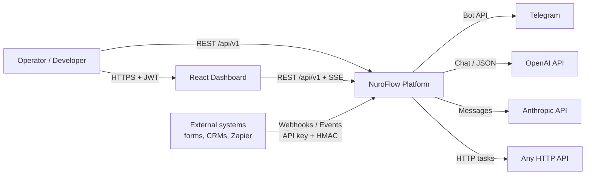
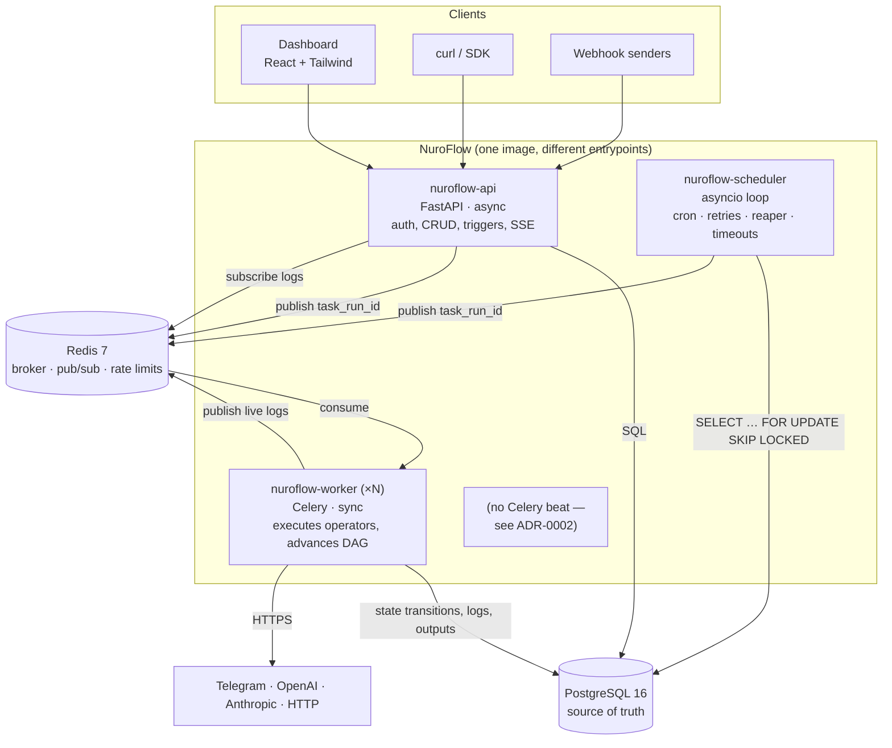
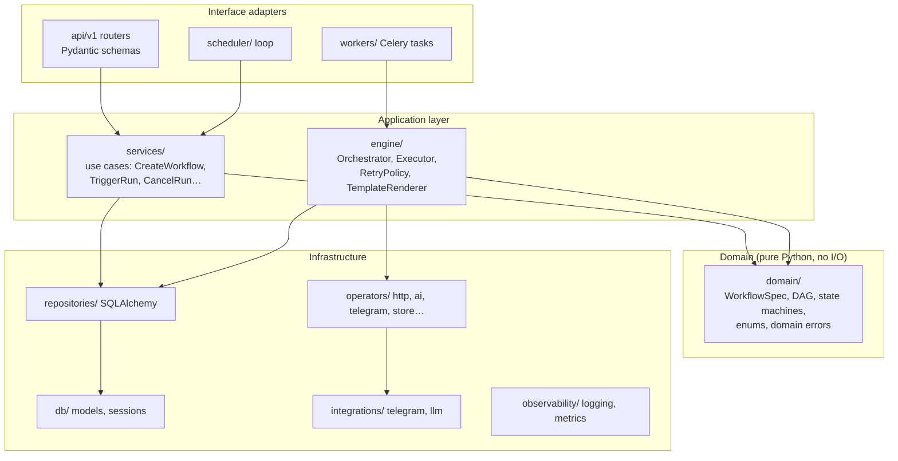
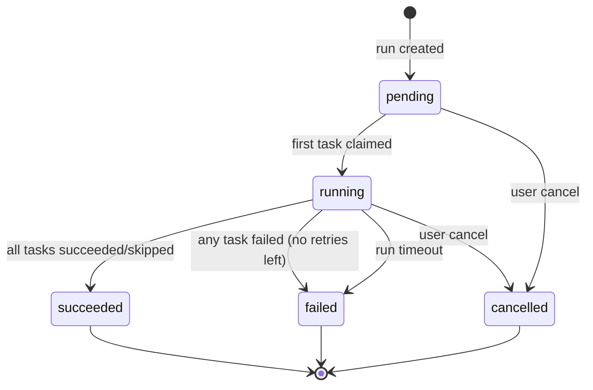
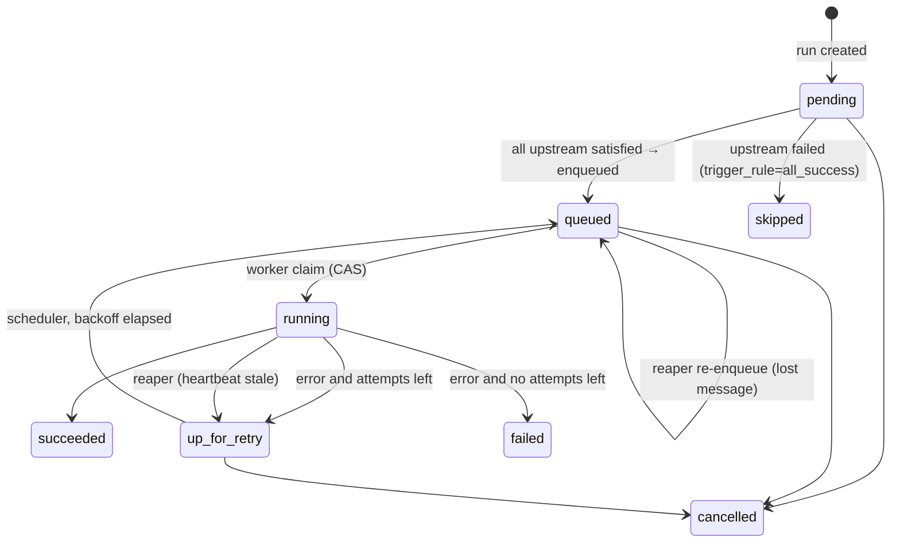

# NuroFlow — System Architecture

> Status: **Phase 1 — accepted design**. This document is the contract every later phase builds against.
> When code and this document disagree, one of them is a bug.

---

## 1. What NuroFlow is (and is not)

NuroFlow is a **workflow orchestration platform**: you declare a workflow as a DAG of tasks, attach
triggers (cron, event, webhook, manual), and the platform executes it reliably — with retries,
dependency ordering, logs, history, notifications, and AI-powered task types.

| NuroFlow **is** | NuroFlow **is not** |
|---|---|
| A declarative DAG engine with durable state in PostgreSQL | An Airflow clone (no Python-file DAG parsing, no executors zoo) |
| Built for business automations (leads, content, ops alerts) | A big-data / Spark scheduler |
| Safe-by-default: workflows are data, not code | A remote code execution service |
| Horizontally scalable at the worker tier | A distributed consensus system |

**Design principle that drives everything else:** *PostgreSQL is the single source of truth for
workflow state. Redis/Celery is only a delivery mechanism.* If Redis is wiped mid-run, NuroFlow
recovers every in-flight run from the database. (See [ADR-0001](adr/0001-postgres-as-source-of-truth.md).)

---

## 2. System context



---

## 3. Container architecture

NuroFlow ships as **four stateless processes** built from **one Python codebase and one Docker
image**, plus two stateful services.



### 3.1 `nuroflow-api` (FastAPI, async)

- REST API under `/api/v1` (versioned by URL prefix; see §8).
- Authentication (JWT access + rotating refresh tokens), RBAC, API keys for machine clients.
- Workflow CRUD + **immutable versioning** (every save creates a `workflow_version`).
- Trigger ingestion: manual runs, `POST /events`, signed webhooks.
- Run control: cancel, retry-from-failed, pause workflow.
- Read models: run history, task timelines, logs (paginated + live tail via **Server-Sent Events**).
- `/healthz` (liveness), `/readyz` (DB + Redis), `/metrics` (Prometheus).
- **Never executes tasks.** Creating a run = one DB transaction + enqueueing root tasks.

### 3.2 `nuroflow-scheduler` (asyncio service)

A single long-running loop that does four DB-driven jobs every tick (default 5s):

| Job | Query shape | Purpose |
|---|---|---|
| **Cron firing** | `workflow_triggers WHERE next_fire_at <= now() FOR UPDATE SKIP LOCKED` | Create runs for due cron triggers, advance `next_fire_at` |
| **Retry dispatch** | `task_runs WHERE status='up_for_retry' AND next_attempt_at <= now()` | Re-enqueue tasks whose backoff elapsed |
| **Reaper** | `task_runs WHERE status IN ('queued','running') AND heartbeat stale` | Recover tasks lost by dead workers or a wiped broker |
| **Timeouts** | `workflow_runs WHERE status='running' AND deadline passed` | Fail runs that exceed `timeout_seconds` |

`SKIP LOCKED` makes it **safe to run multiple schedulers** (HA) with no leader election and no
double-firing. Run creation is additionally protected by a unique `idempotency_key`
(`cron:{trigger_id}:{scheduled_for}`), so even a bug cannot create duplicate runs.

### 3.3 `nuroflow-worker` (Celery, sync)

- Consumes messages containing **only a `task_run_id`** — never payloads.
- Claims the task with a compare-and-set update (`UPDATE … SET status='running' WHERE id=:id AND
  status='queued'`). Zero rows updated ⇒ duplicate delivery ⇒ ack and exit. This is what makes
  at-least-once delivery behave like exactly-once execution.
- Renders inputs (sandboxed Jinja), resolves the **operator** from the registry, executes it with a
  timeout, persists output/error and an attempt record, then calls the **Orchestrator** to advance
  the DAG.
- Three queues with separate concurrency: `default`, `ai` (LLM calls, rate-limited), `notifications`.

### 3.4 PostgreSQL 16

Holds every piece of durable state: users, credentials (encrypted), workflow definitions and
versions, triggers, events, runs, task runs, attempts, logs, notifications. Row locks
(`SELECT … FOR UPDATE`) serialize DAG advancement per run.

### 3.5 Redis 7

- Celery broker (queues `default`, `ai`, `notifications`).
- Pub/sub channel per task run for **live log tailing** (`logs:{task_run_id}`).
- Token-bucket rate limiting (login attempts, LLM calls per provider).
- Short-lived caches (e.g. JWT denylist for logged-out access tokens).

Redis holds **nothing that cannot be rebuilt**. Losing it costs latency, not correctness.

### 3.6 Dashboard (React + Tailwind, Phase 6)

SPA served by nginx in production. Workflow list, DAG visualizer (React Flow), run timeline
(Gantt-style), live logs (SSE), trigger management, metrics overview.

---

## 4. Internal architecture (Clean Architecture)



**Dependency rule:** arrows point inward. `domain/` imports nothing from the project except itself.
Services depend on repository **interfaces** (`typing.Protocol`), and concrete SQLAlchemy
repositories are injected — in FastAPI via `Depends`, in workers via a small composition root
(`workers/container.py`). That is what makes the engine unit-testable with in-memory fakes.

### SOLID, concretely

| Principle | Where it shows up |
|---|---|
| **S**ingle responsibility | `Orchestrator` decides *what* runs next; `Executor` decides *how* one task runs; `Scheduler` decides *when* |
| **O**pen/closed | New task types are new `Operator` classes registered by name — the engine never changes |
| **L**iskov | Every `LLMProvider` (OpenAI, Anthropic, Fake) is interchangeable behind one Protocol |
| **I**nterface segregation | `RunRepository` and `TaskRunRepository` are separate; operators get a narrow `OperatorContext`, not a DB session |
| **D**ependency inversion | Services receive repositories / clock / id-generator; nothing calls `datetime.now()` or opens sessions directly |

---

## 5. Core domain concepts

| Concept | Description | Table |
|---|---|---|
| **Workflow** | A named, owned automation. Mutable metadata (name, paused). | `workflows` |
| **WorkflowVersion** | Immutable snapshot of the DAG definition (JSONB) + checksum. Runs pin a version → reproducible history. | `workflow_versions` |
| **Task (spec)** | Node in the DAG: `key`, `operator`, `inputs`, `depends_on`, `retries`, `timeout`, `trigger_rule`. Lives inside the version JSON. | — |
| **Trigger** | What starts a run: `cron`, `event`, `webhook`, `manual`. | `workflow_triggers` |
| **Event** | An inbound fact (`lead.captured`) with payload; fan-out to matching event triggers. | `events` |
| **WorkflowRun** | One execution of one version. | `workflow_runs` |
| **TaskRun** | One task within a run (one row per task key per run). | `task_runs` |
| **TaskAttempt** | One try of a TaskRun (retries create new attempts). Holds error, traceback, metrics (tokens, cost). | `task_attempts` |
| **TaskLog** | Structured log lines emitted by an operator during an attempt. | `task_logs` |
| **Connection** | Encrypted credentials (Telegram bot token, OpenAI key…) referenced by name. | `connections` |
| **NotificationChannel / Subscription / Delivery** | Where alerts go, which run events trigger them, and an audit of every send. | `notification_*` |

### 5.1 Workflow definition format

Workflows are **data** — YAML or JSON validated by a Pydantic model (`domain/workflow_spec.py`,
Phase 3). Example ([examples/workflows/lead-qualification.yaml](../examples/workflows/lead-qualification.yaml)):

```yaml
name: Lead Qualification
triggers:
  - type: event
    event_type: lead.captured
tasks:
  - key: qualify
    operator: ai.structured
    retries: 3
    inputs:
      provider: anthropic
      model: claude-sonnet-4-5
      prompt: "Score this lead 0-100 and explain: {{ trigger.payload | tojson }}"
      output_schema:            # JSON Schema; the answer is validated before anyone sees it
        type: object
        required: [score, tier, reason]
        properties: { score: { type: integer }, tier: { enum: [hot, warm, cold] }, reason: { type: string } }
  - key: store
    operator: data.store
    depends_on: [qualify]
    inputs:
      collection: qualified_leads
      record: { lead: "{{ trigger.payload }}", score: "{{ tasks.qualify.output.score }}" }
  - key: summarize
    operator: ai.complete
    depends_on: [store]
    inputs: { provider: openai, model: gpt-4o-mini, prompt: "One-line sales summary: {{ tasks.qualify.output | tojson }}" }
  - key: alert
    operator: telegram.send
    depends_on: [summarize]
    inputs: { chat_id: "{{ params.sales_chat_id }}", text: "🔥 New {{ tasks.qualify.output.tier }} lead: {{ tasks.summarize.output.text }}" }
```

The final step from the brief ("Mark Workflow Complete") is **not a task** — it's the engine
transitioning the run to `succeeded` when every task is terminal. Modelling it as a task would
leak engine responsibilities into user space.

### 5.2 State machines

**WorkflowRun**



**TaskRun**



Transitions are enforced in one place (`domain/state.py`, Phase 3). Illegal transitions raise
`InvalidStateTransition` — they are bugs, not user errors.

---

## 6. Data flow

### 6.1 Event → run → completion (the example workflow)

```mermaid
sequenceDiagram
    autonumber
    participant Form as Lead form
    participant API as nuroflow-api
    participant PG as PostgreSQL
    participant RD as Redis
    participant W as nuroflow-worker
    participant LLM as Anthropic / OpenAI
    participant TG as Telegram

    Form->>API: POST /api/v1/events {type: lead.captured, payload}<br/>X-API-Key, Idempotency-Key
    API->>PG: BEGIN; INSERT event; match triggers;<br/>INSERT workflow_run (pinned version) + task_runs (pending)<br/>mark root tasks queued; COMMIT
    API->>RD: enqueue task_run_id(qualify) → queue "ai"
    API-->>Form: 202 Accepted {event_id, run_ids}
    RD->>W: deliver task_run_id
    W->>PG: CAS queued→running, INSERT attempt #1
    W->>LLM: structured prompt (timeout 60s)
    LLM-->>W: {"score": 87, "tier": "hot", ...}
    W->>PG: validate vs schema; SET output, succeeded
    W->>PG: Orchestrator: SELECT run FOR UPDATE;<br/>find tasks whose deps are satisfied → queued
    W->>RD: enqueue store
    Note over W,PG: store → summarize repeat the same claim/execute/advance loop
    W->>TG: sendMessage (alert task)
    W->>PG: alert succeeded → Orchestrator sees all terminal → run succeeded
    W->>RD: enqueue notification(run.succeeded)
```

### 6.2 Failure and retry

1. Operator raises (e.g. `RetryableError` — HTTP 429/5xx, timeout).
2. Executor records attempt `failed` with error type, message, traceback.
3. `RetryPolicy` computes `next_attempt_at = now + min(base · 2^n, cap) ± jitter`.
4. Task → `up_for_retry`. **Nothing is put on the broker.**
5. Scheduler's retry job finds it when due → `queued` → enqueue.
6. `NonRetryableError` (bad input, 4xx, schema violation) skips straight to `failed`.
7. On final failure: downstream tasks with `trigger_rule=all_success` → `skipped`; run → `failed`;
   `run.failed` notification fires.

Why the scheduler instead of Celery's `countdown`? See [ADR-0003](adr/0003-engine-managed-retries.md):
with a Redis broker, delayed messages live in worker memory and are lost on restart; a DB row is not.

### 6.3 Data passing between tasks

- Each task's return value is stored as JSONB in `task_runs.output` (capped at 256 KB; larger
  payloads → object storage reference, roadmap).
- Inputs are rendered **at execution time** with a `jinja2.sandbox.SandboxedEnvironment` and
  `StrictUndefined`. Template context: `params`, `trigger.payload`, `tasks.<key>.output`, `run`
  metadata, `now()`. The rendered input is persisted to `task_runs.input` for debugging.
- Sandboxing blocks attribute access to Python internals — template injection cannot escape.

### 6.4 Cron flow

Trigger saved → API computes `next_fire_at` with `croniter` in the trigger's IANA timezone →
scheduler tick locks due triggers (`SKIP LOCKED`) → inserts run with
`idempotency_key = cron:{trigger_id}:{scheduled_for_iso}` → computes next fire time → commits.
Missed fires (scheduler down for 3 hours) follow `catchup`: `false` (default) fires once and jumps to
the next future time; `true` backfills each missed slot (bounded by `max_active_runs`).

---

## 7. Technology choices

| Technology | Why it was chosen | Alternatives considered |
|---|---|---|
| **Python 3.12+** | Typing (`type` aliases, PEP 695 generics), speed gains, AI SDK ecosystem | Go (faster, but weaker AI/data ecosystem for this audience) |
| **FastAPI** | Async, Pydantic v2 validation, auto OpenAPI docs, first-class DI via `Depends` | Django REST (heavier, sync-first), Litestar (great, smaller community) |
| **PostgreSQL 16** | ACID state machine, row locks, `SKIP LOCKED` queues, JSONB for definitions/outputs, partial indexes | MySQL (weaker JSON + `SKIP LOCKED` story), MongoDB (no multi-row transactions worth trusting here) |
| **SQLAlchemy 2.0** | Typed `Mapped[]` models, sync + async from one model set, Unit of Work | SQLModel (thin wrapper, lags SQLAlchemy features), raw SQL (no migrations story) |
| **psycopg 3** | One driver for sync (worker, Alembic) and async (API) | asyncpg (faster async, but needs a second sync driver) |
| **Alembic** | The standard for SQLAlchemy migrations; autogenerate + review | Hand-written SQL (no drift detection) |
| **Redis 7** | Broker + pub/sub + rate limiting in one dependency | RabbitMQ (better broker semantics, but a 2nd stateful service; our DB-driven reaper closes the gap) |
| **Celery 5** | Mature, prefetch/ack controls, queue routing, worker autoscaling | RQ (simpler, fewer controls), Dramatiq (cleaner, smaller ecosystem), **Temporal** (best-in-class durable execution — but it *is* the orchestrator; using it would hide the engineering this project exists to show) |
| **croniter** | Battle-tested cron parsing with timezone support | APScheduler (in-memory job store by default; we want DB-backed) |
| **JWT (PyJWT) + Argon2 (argon2-cffi)** | Stateless access tokens; Argon2id is the OWASP-recommended password hash | Sessions + cookies (great for dashboards, worse for API clients — we support both via refresh cookie in Phase 6) |
| **Jinja2 sandbox** | Familiar templating with a hardened sandbox | JMESPath (safer but too limited for string building) |
| **Telegram Bot API (httpx)** | Zero-cost, instant mobile alerts; simple HTTPS API | Slack (paid workspaces), email (slow, deliverability work) |
| **OpenAI + Anthropic SDKs** | Behind one `LLMProvider` Protocol → swap per task, failover, fake provider in tests | LangChain (heavy abstraction; hides what we want to demonstrate) |
| **structlog + Prometheus** | JSON logs with bound context (`run_id`, `task_run_id`); standard metrics scraping | OpenTelemetry (planned add-on for traces in Phase 6) |
| **Docker + Compose** | One image, four entrypoints; reproducible dev = prod parity | Kubernetes manifests (roadmap; Compose is the honest scope for a portfolio) |
| **uv** | 10–100× faster installs, lockfile, single tool for venvs | Poetry (slower), pip-tools (more moving parts) |
| **Ruff + mypy (strict) + pytest** | Lint/format in one tool; strict typing catches DI mistakes early | Black + isort + flake8 (three tools doing what Ruff does) |

---

## 8. API architecture

- **Versioning:** URL prefix `/api/v1`. Breaking changes ship as `/api/v2` routers mounted side
  by side; v1 gets a `Deprecation` + `Sunset` header for a published window. (Header-based versioning
  was rejected: invisible in logs and browser dev tools, harder for webhook senders.)
- **Resource layout (Phase 2–5):**

| Area | Endpoints |
|---|---|
| Auth | `POST /auth/register`, `POST /auth/login`, `POST /auth/refresh`, `POST /auth/logout`, `POST /auth/logout-all`, `POST /auth/change-password`, `GET /auth/me` |
| Users (admin) | `GET /users`, `GET /users/{id}`, `PATCH /users/{id}` |
| API keys | `GET/POST /api-keys`, `DELETE /api-keys/{id}` |
| Connections | `GET/POST /connections`, `PATCH/DELETE /connections/{id}` (secrets write-only) |
| Workflows | `GET/POST /workflows`, `GET/PATCH/DELETE /workflows/{id}`, `POST /workflows/{id}/versions`, `GET /workflows/{id}/versions`, `POST /workflows/{id}:pause` / `:unpause`, `POST /workflows:validate` |
| Triggers | `GET/POST /workflows/{id}/triggers`, `PATCH/DELETE /triggers/{id}` |
| Runs | `POST /workflows/{id}/runs` (manual), `GET /runs`, `GET /runs/{id}`, `POST /runs/{id}:cancel`, `POST /runs/{id}:retry` |
| Tasks | `GET /runs/{id}/tasks`, `GET /task-runs/{id}/attempts`, `GET /task-runs/{id}/logs`, `GET /task-runs/{id}/logs/stream` (SSE) |
| Events & webhooks | `POST /events`, `POST /hooks/{trigger_id}` (HMAC-SHA256 signed) |
| Notifications | `GET/POST /notification-channels`, `POST /notification-channels/{id}:test`, subscriptions CRUD |
| Ops | `GET /healthz`, `GET /readyz`, `GET /metrics` |

- **Conventions:** cursor pagination (`?limit=&cursor=`) on all lists — offset pagination degrades
  on large `task_logs`; `Idempotency-Key` header on `POST /runs` and `POST /events`; errors use
  **RFC 9457 Problem Details** (`application/problem+json`) with a stable `type` URI and `request_id`.
- **Custom actions** use the `:verb` suffix (Google AIP-136 style) instead of overloading `PATCH`.

---

## 9. Security architecture

| Concern | Control |
|---|---|
| Passwords | Argon2id (argon2-cffi defaults), never logged, constant-time verify |
| Access tokens | JWT HS256 (key derived from the root secret), 15 min TTL; `sub`, `typ`, `jti`, `iat`, `nbf`, `exp`, `iss`, `aud` required; algorithm pinned; time checked against the injected clock |
| Refresh tokens | Opaque random 256-bit, stored **SHA-256 hashed**, rotated on every use; **reuse of a rotated token revokes the whole family** (theft detection) |
| API keys | `nf_<prefix>_<secret>`; only prefix + peppered HMAC-SHA256 stored (high-entropy secret, so a fast hash suffices; see [AUTH.md](AUTH.md)); scoped (`events:write`, `runs:write`); shown once |
| Webhooks | Per-trigger secret, HMAC-SHA256 over `timestamp.body`, 5-minute replay window |
| Credentials at rest | `connections.encrypted_secret` = Fernet (AES-128-CBC + HMAC) with key from env / secret manager; key rotation via `MultiFernet` |
| Authorization | RBAC (`admin`, `editor`, `viewer`) + ownership checks in services (not only routers) |
| Code execution | **No arbitrary user code.** Operators are vetted classes; templates run in Jinja's sandbox ([ADR-0004](adr/0004-declarative-operators-no-arbitrary-code.md)) |
| SSRF (`http.request`) | Resolve DNS and block private, loopback, link-local and metadata ranges; allowlist optional |
| LLM prompt injection | Lead data is untrusted input: LLM output is validated against a JSON schema and can never choose operators, connections, or recipients |
| Abuse | Redis token-bucket limits on login, events and webhooks |
| Transport/headers | TLS at the proxy, strict CORS allowlist, security headers middleware, request size limits |
| Supply chain | Pinned lockfile, `pip-audit` + Trivy image scan in CI, non-root container user |

---

## 10. Reliability guarantees

| Failure | What happens |
|---|---|
| Duplicate Celery delivery | CAS claim fails → no-op |
| Worker dies mid-task | Heartbeat stops → reaper moves task to `up_for_retry` (counts as an attempt) |
| Redis wiped | `queued` tasks have no message → reaper re-enqueues after `queued_timeout` |
| Two schedulers running | `SKIP LOCKED` + idempotency keys → each trigger fires once |
| API crashes after commit, before enqueue | Root tasks are `queued` in DB → reaper enqueues them (this is the **outbox-lite** pattern; full transactional outbox is the documented upgrade path) |
| Two upstream tasks finish at once | Orchestrator locks the `workflow_runs` row → successors evaluated exactly once |
| Provider outage (OpenAI 5xx) | `RetryableError` → exponential backoff; optional provider failover per task |

Delivery semantics: **at-least-once execution of operators, exactly-once state transitions.**
Operators with side effects (Telegram send, DB store) receive an `idempotency_key`
(`{task_run_id}:{attempt}`) to deduplicate downstream where the target supports it.

---

## 11. Observability

- **Logs:** structlog JSON to stdout; every line bound with `request_id` / `run_id` /
  `task_run_id` / `attempt` via `contextvars`. Operator logs additionally persisted to `task_logs`
  and published to Redis for live tail.
- **Metrics (Prometheus):** `nuroflow_runs_total{status}`, `nuroflow_task_duration_seconds{operator}`
  (histogram), `nuroflow_task_retries_total`, `nuroflow_queue_depth{queue}`,
  `nuroflow_scheduler_lag_seconds`, `nuroflow_llm_tokens_total{provider,model}`,
  `nuroflow_llm_cost_usd_total`, HTTP RED metrics.
- **Error tracking:** every attempt stores `error_type`, message, and traceback; optional Sentry DSN.
- **Dashboards:** Grafana dashboard JSON committed in `deploy/grafana/` (Phase 6).

---

## 12. Scalability notes

- API and workers scale horizontally; the scheduler scales to N replicas safely.
- Hot tables (`task_runs`, `task_logs`) are indexed for their actual access paths (see
  [DATABASE.md](DATABASE.md)). `task_logs` is the first candidate for **monthly range partitioning**
  and a retention job once volume demands it.
- Expected ceiling of this design on one Postgres: thousands of task executions per minute. Beyond
  that: partitioning, read replicas for history queries, and moving logs to Loki/ClickHouse.

---

## 13. Repository structure

```text
nuroflow/
├── README.md                     # Pitch, quick start, roadmap
├── Makefile                      # One-word dev commands (make up, make test, make migrate)
├── docker-compose.dev.yml        # Postgres + Redis for local dev (Phase 1)
├── docker-compose.yml            # Full stack: api, scheduler, worker, dashboard (Phase 7)
├── .env.example                  # Every setting, documented
├── .pre-commit-config.yaml       # Ruff, mypy, hygiene hooks
├── docs/
│   ├── ARCHITECTURE.md           # This document
│   ├── DATABASE.md               # Schema, ERD, index rationale
│   ├── DEVELOPMENT.md            # Local setup guide
│   └── adr/                      # Architecture Decision Records
├── examples/workflows/           # Ready-to-import workflow definitions
├── backend/
│   ├── pyproject.toml            # Deps, Ruff, mypy, pytest config
│   ├── alembic.ini
│   ├── alembic/                  # env.py + versioned migrations
│   ├── src/nuroflow/
│   │   ├── core/                 # config, ids, security, exceptions          (P1–P2)
│   │   ├── domain/               # enums, WorkflowSpec, DAG, state machines   (P1, P3)
│   │   ├── db/                   # Base, mixins, models, sessions             (P1–P2)
│   │   ├── repositories/         # Protocols + SQLAlchemy implementations     (P2–P3)
│   │   ├── services/             # Use cases (auth, workflows, runs, events)  (P2–P4)
│   │   ├── api/                  # FastAPI app factory, deps, v1 routers      (P2)
│   │   ├── engine/               # Orchestrator, Executor, RetryPolicy, templating (P3–P4)
│   │   ├── operators/            # Task types + registry                      (P3, P5)
│   │   ├── scheduler/            # Cron, retry dispatch, reaper, timeouts     (P4)
│   │   ├── workers/              # Celery app, task entrypoints, container    (P3)
│   │   ├── integrations/         # telegram/, llm/ (OpenAI, Anthropic, fake)  (P5)
│   │   ├── notifications/        # Channel dispatch + delivery tracking       (P5)
│   │   └── observability/        # structlog setup, Prometheus metrics        (P6)
│   └── tests/
│       ├── unit/                 # Pure, fast, no I/O
│       └── integration/          # Real Postgres/Redis (CI services)
├── frontend/                     # React + Tailwind dashboard                 (P6)
└── deploy/                       # Dockerfiles, nginx, Grafana, CI assets      (P7)
```

**Why a `src/` layout?** It forces tests to run against the *installed* package, catching
packaging mistakes (missing files, wrong imports) that a flat layout hides until deployment.

**Why one image for four processes?** One build, one vulnerability scan, one version tag. The
process role is just the container command (`nuroflow-api`, `nuroflow-scheduler`, `celery -A …`).

---

## 14. Phase plan

| Phase | Deliverable | Exit criteria |
|---|---|---|
| **1** ✅ | Architecture, repo scaffold, full DB schema + initial migration, dev environment | `make up && make migrate` creates schema; upgrade/downgrade round-trips; drift check passes |
| **2** ✅ | FastAPI app factory, settings, DB sessions, auth (JWT, refresh rotation, API keys, RBAC) | Auth flows covered by tests; OpenAPI published |
| **3** ✅ | WorkflowSpec + DAG validation, Orchestrator, Executor, operator registry, Celery worker | Example workflow runs end-to-end with fake LLM/Telegram |
| **4** ✅ | Scheduler (cron, retries, reaper, timeouts), events & webhooks | Chaos test: kill worker + flush Redis mid-run → run still completes |
| **5** | Telegram, OpenAI, Anthropic integrations, notification service | Real alert delivered; LLM token/cost metrics recorded |
| **6** | structlog, Prometheus, SSE log tail, React dashboard | Grafana board + dashboard screenshots in README |
| **7** | Production Dockerfiles, Compose stack, hardening, GitHub Actions CI/CD, coverage ≥ 85% | Green CI badge; `docker compose up` brings up the full platform |

---

## 15. Decision log

| ADR | Decision |
|---|---|
| [0001](adr/0001-postgres-as-source-of-truth.md) | PostgreSQL is the source of truth; the broker only carries IDs |
| [0002](adr/0002-db-driven-scheduler.md) | Custom DB-driven scheduler instead of Celery beat |
| [0003](adr/0003-engine-managed-retries.md) | Engine-managed retries instead of Celery `autoretry_for` / countdown |
| [0004](adr/0004-declarative-operators-no-arbitrary-code.md) | Declarative operators; no arbitrary user code |
| [0005](adr/0005-async-api-sync-workers.md) | Async API, sync workers, shared models |
| [0006](adr/0006-string-enums-and-uuidv7.md) | VARCHAR + CHECK enums and app-generated UUIDv7 keys |

Phase 2 authentication design and its alternatives: [AUTH.md](AUTH.md).
Phase 3 engine internals, guarantees and alternatives: [ENGINE.md](ENGINE.md).
Phase 4 scheduler, triggers, backpressure and chaos results: [SCHEDULER.md](SCHEDULER.md).
