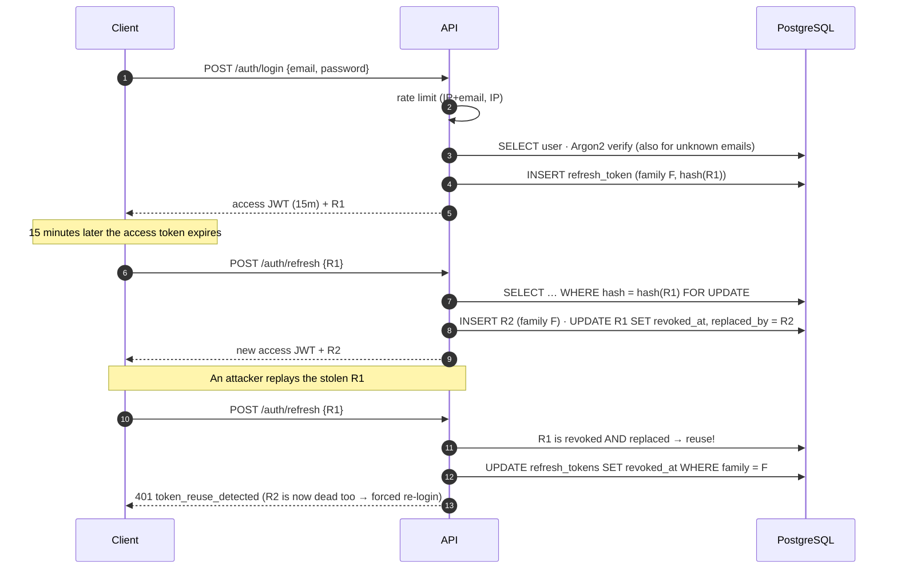

# NuroFlow — Authentication & Authorization

Phase 2 · code in `core/security.py`, `services/auth.py`, `services/api_keys.py`, `api/deps.py`

## Credentials at a glance

| Credential | Who uses it | Lifetime | Stored as | Revocation |
|---|---|---|---|---|
| **Access token** (JWT, HS256) | Dashboard, CLI, scripts | 15 min | Not stored | Expires; user deactivation or role change applies immediately (DB check per request) |
| **Refresh token** (opaque, 256-bit) | Dashboard, CLI | 14 days, rotated on every use | SHA-256 hash | Logout (one session), logout-all, password change, reuse detection |
| **API key** `nf_<prefix>_<secret>` | Webhooks, forms, CI, Zapier | Optional expiry (1–365 days) | Prefix + HMAC-SHA256 | `DELETE /api-keys/{id}` |
| **Password** | Humans | n/a | Argon2id | Change password |

## Login and refresh rotation



Why revoke the whole family? When a rotated token is replayed, the server can't tell
whether the attacker or the real user is replaying it. Killing the family logs out both,
so the real user logs in again with their password, which the attacker doesn't have.
This follows OAuth 2.0 Security BCP (RFC 9700 §4.14).

## Authorization model

Roles grant **scopes**. Endpoints require **scopes**, never roles.

| Scope | viewer | editor | admin | Allowed on API keys |
|---|:---:|:---:|:---:|:---:|
| `workflows:read` | ✅ | ✅ | ✅ | ✅ |
| `workflows:write` | | ✅ | ✅ | ✅ |
| `runs:read` | ✅ | ✅ | ✅ | ✅ |
| `runs:write` | | ✅ | ✅ | ✅ |
| `events:write` | | ✅ | ✅ | ✅ |
| `users:admin` | | | ✅ | ❌ never |

- **API key scopes = requested ∩ owner's *current* role.** Demoting a user instantly narrows
  every key they own.
- API keys can't create API keys. Key management needs an interactive login.
- Ownership: resources are visible to their owner, plus admins authenticated by JWT.
- Unauthorized access to someone else's resource returns **404, not 403**, so IDs can't be probed.

## Defences checklist

| Threat | Mitigation |
|---|---|
| Password brute force | Fixed-window limits: 10 / 5 min per (IP, email), 50 / 5 min per IP → `429` + `Retry-After` |
| User enumeration | Identical error text, and an Argon2 verify runs even for unknown emails (equal timing) |
| Long-password DoS | Schema caps at 256 chars; policy caps at 128 before hashing |
| JWT `alg=none` / algorithm confusion | Algorithm pinned on decode; `iss`, `aud`, `typ`, `nbf`, `exp` all required |
| Key reuse across purposes | JWT key and API-key pepper are **derived** separately from `NUROFLOW_SECRET_KEY` (HMAC KDF) |
| DB dump leaks credentials | Passwords Argon2id, refresh tokens SHA-256, API keys peppered HMAC: a dump alone is useless |
| Stolen refresh token | Rotation + family revocation on reuse |
| Leaked API key in a public repo | Recognisable `nf_` prefix for secret scanners; per-key revoke; optional expiry |
| Header injection via `X-Request-ID` | Strict allowlist regex; otherwise a fresh ID is generated |
| Secrets in error responses | Validation errors never echo `input`; 500s are generic, details go to logs |
| Unsafe production config | Startup fails if the dev secret or `*` CORS is used in staging/production |
| First-admin takeover | No "first user becomes admin". `nuroflow create-admin` CLI only |

## Design decisions & alternatives

**API keys use HMAC-SHA256, not Argon2** *(changed from the first architecture draft)*.
The secret is 256 random bits, so brute force is already impossible, and a slow hash would
add about 50 ms of CPU to every machine request for no security gain. A server-side pepper
means a database dump alone can't even confirm a guess. GitHub and Stripe use the same pattern.

**Strict rotation vs a reuse grace window.** Two browser tabs refreshing at the same
moment will trip reuse detection. Our choice: strict. The dashboard (Phase 6) will funnel
refreshes through one in-flight promise. The alternative is to accept a just-rotated token
for about 10 seconds, which is friendlier but gives a narrow replay window.

**No access-token denylist.** Logout revokes the refresh family. The access token dies
within 15 minutes, and deactivation is enforced immediately by the per-request user lookup.
A Redis `jti` denylist is a small addition if instant access-token revocation is ever required.

**Bearer tokens in JSON vs httpOnly cookies.** API clients need bearer tokens. For the
browser dashboard (Phase 6) we'll add an httpOnly, `SameSite=Strict` refresh cookie, so
JavaScript never sees the refresh token.

**Fixed-window rate limiting.** Two O(1) Redis commands. It allows up to 2x bursts at
window edges, which is fine for login. It fails open if Redis is down (availability over
strictness), and that's logged.

## Try it

```bash
make admin email=you@example.com          # prompts for a password
make api                                  # http://127.0.0.1:8000/docs

TOKEN=$(curl -s -X POST localhost:8000/api/v1/auth/login \
  -H 'content-type: application/json' \
  -d '{"email":"you@example.com","password":"…"}' | jq -r .access_token)

curl -s localhost:8000/api/v1/auth/me -H "Authorization: Bearer $TOKEN" | jq

curl -s -X POST localhost:8000/api/v1/api-keys -H "Authorization: Bearer $TOKEN" \
  -H 'content-type: application/json' \
  -d '{"name":"lead-form","scopes":["events:write"],"expires_in_days":90}' | jq -r .key
```
