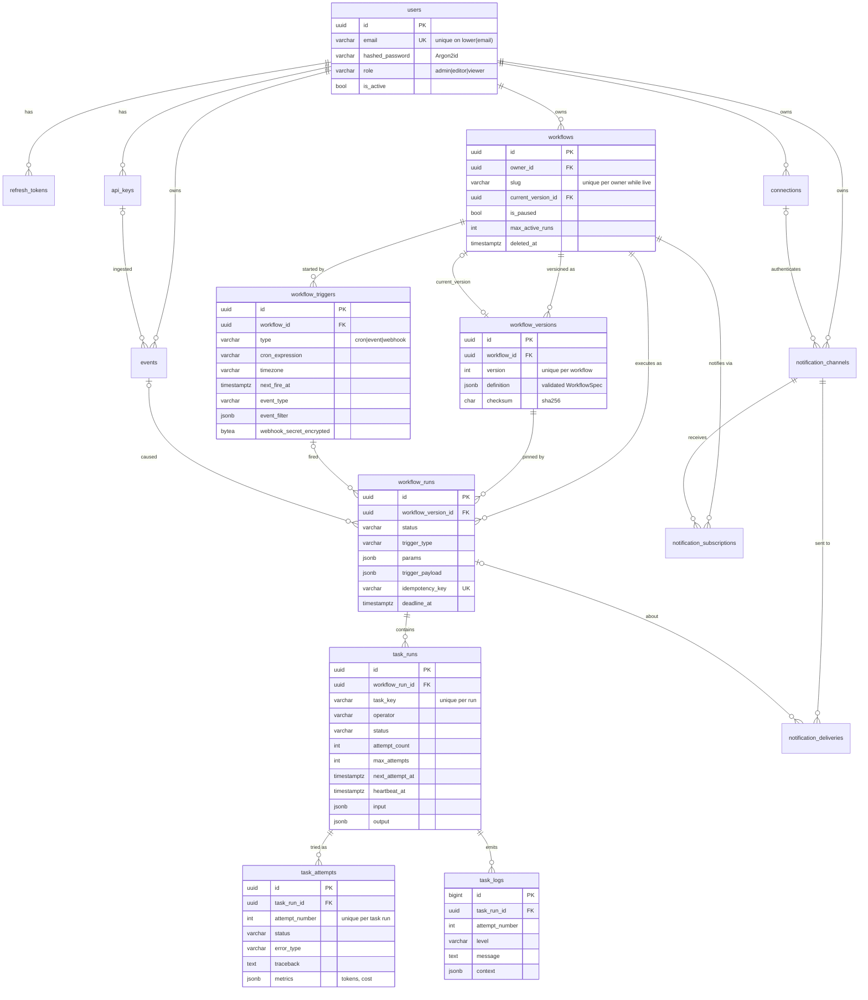

# NuroFlow — Database Design

PostgreSQL 16 · 15 tables · migration `0001_initial_schema` · models in
[`backend/src/nuroflow/db/models/`](../backend/src/nuroflow/db/models/)

## Conventions

| Rule | Why |
|---|---|
| UUIDv7 primary keys (app-generated) | Time-ordered → index-friendly inserts; IDs known before flush ([ADR-0006](adr/0006-string-enums-and-uuidv7.md)) |
| `task_logs.id` is `BIGINT IDENTITY` | Append-only, internal, smallest possible key, natural tail order |
| Every timestamp is `timestamptz` | Naive datetimes are the #1 scheduler bug; enforced by a unit test |
| Enums = `VARCHAR` + named `CHECK` | Transactional, reversible enum changes |
| Deterministic constraint names (`pk_`, `fk_`, `uq_`, `ck_`, `ix_`) | Migrations can drop/alter constraints by name; enforced by a unit test |
| JSON columns are `JSONB` defaulting to `'{}'` | No `NULL` vs `{}` ambiguity; GIN-indexable later |
| Every FK is indexed (or allowlisted with a reason) | Postgres doesn't auto-index FKs; enforced by a unit test |
| Soft delete only where history matters (`workflows.deleted_at`) | Run history must survive "delete workflow"; everything else hard-deletes |
| Relationships default to `lazy="raise"` | N+1 queries become loud errors instead of silent slowness |

## Entity-relationship diagram



## Table reference

### Identity & access

| Table | Purpose | Key constraints |
|---|---|---|
| `users` | Accounts + RBAC role | `uq_users_email_lower` (functional, case-insensitive); `ck_users_role` |
| `refresh_tokens` | Rotating refresh tokens (SHA-256 hash only) | `token_hash` unique; `family_id` indexed for family-wide revocation; self-FK `replaced_by_id` builds the rotation chain |
| `api_keys` | Machine credentials | `prefix` unique (O(1) lookup); `key_hash` Argon2id; `scopes text[]` |
| `connections` | Encrypted third-party credentials | `uq(owner_id, name)`; `encrypted_secret bytea` (Fernet) never leaves the API |

### Definitions

| Table | Purpose | Key constraints |
|---|---|---|
| `workflows` | Mutable metadata | Partial unique `(owner_id, slug) WHERE deleted_at IS NULL`; slug regex CHECK; `max_active_runs > 0` |
| `workflow_versions` | Immutable DAG snapshots | `uq(workflow_id, version)`; `version > 0`. The `workflows ↔ versions` circular FK is created after both tables exist |
| `workflow_triggers` | Cron / event / webhook triggers | Type-conditional CHECKs (cron ⇒ expression, event ⇒ event_type, webhook ⇒ secret) |

### Ingestion & execution

| Table | Purpose | Key constraints |
|---|---|---|
| `events` | Inbound facts for event triggers | `uq(owner_id, idempotency_key)` deduplicates client retries |
| `workflow_runs` | One execution of one version | `idempotency_key` unique ⇒ exactly-once run creation; `finished_at >= started_at` |
| `task_runs` | One task in one run | `uq(workflow_run_id, task_key)`; `0 ≤ attempt_count ≤ max_attempts` |
| `task_attempts` | One try (error tracking) | `uq(task_run_id, attempt_number)`; `attempt_number ≥ 1` |
| `task_logs` | Structured operator logs | Append-only; `(task_run_id, id)` index for keyset tailing |

### Notifications

| Table | Purpose | Key constraints |
|---|---|---|
| `notification_channels` | Telegram chat / webhook destination | `uq(owner_id, name)`; FK to `connections` is `RESTRICT` (can't delete an in-use credential) |
| `notification_subscriptions` | Workflow → channel routing per event | `events <@ ARRAY[known events]` and non-empty CHECKs |
| `notification_deliveries` | Outbox + audit for every alert | Partial index on pending deliveries for the dispatcher |

## Index → query map

Every non-FK index exists for a specific query. If a query changes, revisit its index.

| Index | Serves |
|---|---|
| `ix_workflow_triggers_due_cron` (partial: enabled cron) | Scheduler: `WHERE next_fire_at <= now() … FOR UPDATE SKIP LOCKED` |
| `ix_workflow_triggers_event_type_enabled` (partial) | Event fan-out: `WHERE event_type = :type` |
| `ix_workflow_runs_workflow_id_created_at` (`created_at DESC`) | Run history pages per workflow |
| `ix_workflow_runs_active` (partial: pending/running) | `max_active_runs` enforcement, "running now" widget |
| `ix_workflow_runs_deadline_running` (partial) | Scheduler run-timeout sweep |
| `ix_task_runs_retry_due` (partial: up_for_retry) | Scheduler retry dispatch |
| `ix_task_runs_in_flight_heartbeat` (partial: queued/running) | Reaper: stale heartbeats / lost messages |
| `ix_task_logs_task_run_id_id` | `WHERE task_run_id = :id AND id > :cursor ORDER BY id LIMIT n` |
| `ix_events_owner_id_type_received_at` | Event browser and replay |
| `ix_notification_deliveries_pending_due` (partial) | Notification dispatcher |

**Why partial indexes?** At steady state, more than 99% of `task_runs` are terminal. A partial index
over `status = 'up_for_retry'` stays tiny however much history accumulates, so scheduler queries
stay fast at a million rows.

## Delete behaviour

| Parent deleted | Children |
|---|---|
| `users` | `RESTRICT` from `workflows` (deactivate users instead); `CASCADE` tokens, keys, connections, events, channels |
| `workflows` | `CASCADE` versions, triggers, runs, subscriptions (normally soft-deleted instead) |
| `workflow_versions` | `RESTRICT` from `workflow_runs`: you can't delete a version that history depends on |
| `workflow_runs` | `CASCADE` task runs → attempts → logs, deliveries |
| `workflow_triggers` / `events` | Runs keep their history (`SET NULL`) |

## Growth & retention plan

| Table | Growth driver | Plan |
|---|---|---|
| `task_logs` | Lines × attempts | Monthly range partitions on `created_at` + `DROP PARTITION` retention (default 30 days) |
| `task_attempts`, `task_runs` | Tasks × runs | Archive runs older than N days to cold storage; partial indexes keep the hot set small |
| `events` | Inbound volume | Retention job (default 90 days) |
| `refresh_tokens` | Logins | Nightly purge of expired/revoked rows |

## Migration workflow

```bash
make migration m="add sla_seconds to workflows"   # autogenerate
#  → review the file: autogenerate is a draft, not the answer
make migrate                                       # apply
make check                                         # includes `alembic check` drift gate
```

Rules for production-safe migrations (enforced in review):

1. Additive first: add nullable column → backfill → add constraint `NOT VALID` → `VALIDATE`.
2. Never rename in one step. Add the new column, dual-write, then drop the old one.
3. `CREATE INDEX CONCURRENTLY` on large tables, in its own non-transactional migration.
4. `lock_timeout = 5s` is set in `env.py`, so a migration fails fast instead of queueing behind
   traffic.
5. Every migration has a working `downgrade()`. The round-trip test runs in CI.
