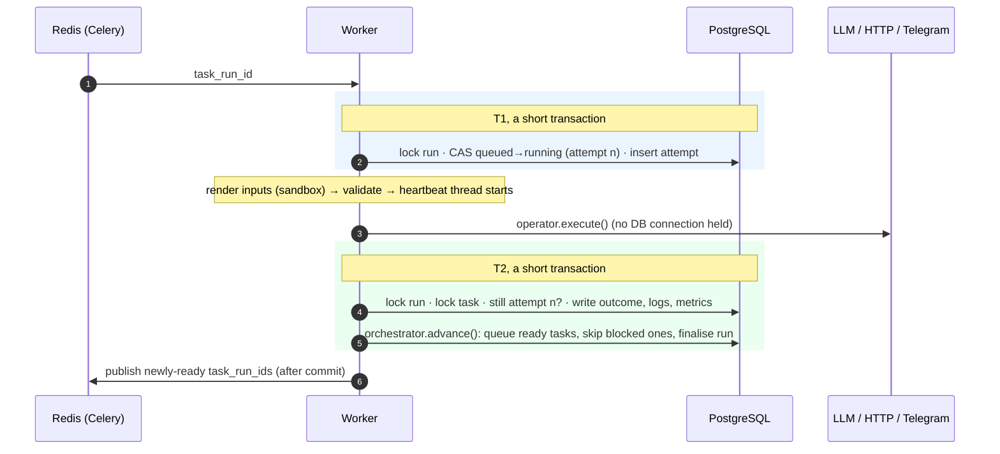

# NuroFlow — Workflow Engine

Phase 3 · code in `domain/` (rules), `engine/` (execution), `operators/` (task types), `workers/` (Celery)

## Writing a workflow

```yaml
slug: lead-qualification            # unique per owner; immutable across versions
name: Lead Qualification
params: { sales_chat_id: "123" }    # defaults; each run can override
defaults: { retries: 2, retry_backoff_seconds: 10, timeout_seconds: 120 }

tasks:
  - key: qualify                    # [a-z][a-z0-9_]*, used as tasks.qualify in templates
    operator: ai.structured
    retries: 3                      # overrides defaults
    inputs:
      provider: anthropic
      prompt: "Score: {{ trigger.payload | tojson }}"
      output_schema: { type: object, required: [score], properties: { score: { type: integer } } }

  - key: alert
    operator: telegram.send
    depends_on: [qualify]
    trigger_rule: all_success       # all_success | none_failed | one_failed | all_done
    inputs:
      chat_id: "{{ params.sales_chat_id }}"
      text: "Score {{ tasks.qualify.output.score }}"
```

Full example: [`examples/workflows/lead-qualification.yaml`](../examples/workflows/lead-qualification.yaml).

### Template context

| Variable | Contents |
|---|---|
| `params` | spec `params` merged with run-time overrides |
| `trigger.type`, `trigger.payload` | `manual`/`cron`/`event`/`webhook` and its payload |
| `tasks.<key>.output`, `.status` | **upstream ancestors only** (enforced at save time) |
| `run.id`, `run.workflow_id`, `run.scheduled_for`, `run.attempt` | run metadata |

- `"{{ expr }}"` alone returns the **native value** (int, dict…); mixed text returns a string.
- Undefined variables **fail the task** (StrictUndefined). There are no silent empty strings in prompts.
- `tojson` outputs plain JSON (not HTML-escaped).
- Rendering is sandboxed: `{{ ''.__class__.__mro__ }}`-style escapes are blocked (tested).

### What's validated before you can save

| Check | Example error |
|---|---|
| Unknown fields (typos) | `tasks.0.depend_on: Extra inputs are not permitted` |
| Cycles, with the path | `dependency cycle: alert → qualify → store → summarize → alert` |
| Reading a non-upstream task | `tasks.store.inputs references tasks.qualify, which is not upstream: add it to depends_on…` |
| Template syntax | `tasks.alert.inputs.text: template syntax error: unexpected end of template` |
| Unknown operator / inputs | `unknown operator 'ai.structurd'`, `missing required input 'chat_id'` |
| Cron and timezone | `invalid 5-field cron expression`, `unknown IANA timezone` |
| JSON Schema in `ai.structured` | `output_schema is not a valid JSON Schema` |

Use `POST /api/v1/workflows:validate` to lint a definition without saving it.

## Operators

| Operator | Queue | Purpose | Failure classification |
|---|---|---|---|
| `noop` | default | Join points, placeholders | n/a |
| `control.delay` | default | Pause ≤ 5 min | n/a |
| `transform.template` | default | Shape data → `output.value` | Template errors are permanent |
| `http.request` | default | Any HTTP API; SSRF-guarded; sends `Idempotency-Key` | 408/425/429/5xx and timeouts retry; other 4xx fail |
| `data.store` | default | Save JSON to a collection; **exactly once per task run** | DB errors retry |
| `ai.complete` | ai | Text generation | Provider decides (429/5xx retry) |
| `ai.structured` | ai | JSON validated against your schema | Invalid JSON / schema mismatch **retry** (LLMs are stochastic) |
| `telegram.send` | notifications | Alerts | Provider decides |

`GET /api/v1/operators` returns every operator with its JSON input schema.
Plugins register more via the `nuroflow.operators` entry-point group.

## How a task executes



| Guarantee | Mechanism |
|---|---|
| Duplicate messages don't run twice | `UPDATE … WHERE status='queued'` compare-and-set claim |
| A join task is queued exactly once | `workflow_runs` row lock in `advance()` (tested with two concurrent workers) |
| No connection held during LLM calls | Execution happens between two short transactions |
| A zombie worker can't overwrite a newer attempt | T2 verifies `attempt_count` still matches |
| No deadlocks | Fixed lock order: run row, then task rows |
| Lost messages recover | Tasks stay `queued` in Postgres; the reaper re-enqueues them (Phase 4) |
| Retries survive restarts | `up_for_retry` + `next_attempt_at` in Postgres; `dispatch_due_retries()` |
| Side effects aren't duplicated | `ctx.idempotency_key` (stable across retries); `data.store` upserts per task run |

### Retries

`delay(n) = min(cap, base · 2^(n-1))`, then **equal jitter**: at least half the delay, and the
rest is random. Full jitter can retry almost instantly, which is pointless against a
rate-limited API. Equal jitter guarantees rest while still breaking up thundering herds.

### Trigger rules

| Rule | Runs when upstream is… | Typical use |
|---|---|---|
| `all_success` (default) | all succeeded | normal flow |
| `none_failed` | succeeded or skipped | after optional branches |
| `one_failed` | at least one failed | error handlers, alerts |
| `all_done` | anything terminal | cleanup, audit logging |

A run is **failed if any task failed**, even if a `one_failed` handler ran afterwards.
Handling an error doesn't erase it from history.

## Running it

```bash
make api        # terminal 1
make worker     # terminal 2  (all queues; or: nuroflow-worker -Q ai -c 2)

curl -X POST localhost:8000/api/v1/workflows:import -H "Authorization: Bearer $TOKEN" \
     -H 'Content-Type: application/yaml' --data-binary @examples/workflows/lead-qualification.yaml

curl -X POST localhost:8000/api/v1/workflows/$WF/runs -H "Authorization: Bearer $TOKEN" \
     -H 'Content-Type: application/json' -H 'Idempotency-Key: lead-42' \
     -d '{"payload": {"name": "Ada", "email": "ada@example.com"}}'

curl localhost:8000/api/v1/runs/$RUN -H "Authorization: Bearer $TOKEN"
```

LLM and Telegram calls are **simulated** in Phase 3 (deterministic, free). Phase 5 swaps in
the real OpenAI, Anthropic and Telegram adapters behind the same ports. No workflow changes.

## Design decisions & alternatives

- **Celery messages carry only an ID.** The payload is read from Postgres at execution time, so a
  message can never be stale or forged into running different inputs (ADR-0001).
- **Celery `soft_time_limit` for timeouts**, not threads. Python can't safely kill a thread.
  Celery raises inside the task and records a retryable `TaskTimeoutError`. The hard limit (soft + 30s)
  kills a task that ignores it.
- **Logs are buffered and written in T2.** That's simple and transactional. The trade-off is that you
  can't see logs from a task that's still running. Phase 6 adds live streaming through Redis pub/sub.
- **Outputs are capped at 256 KB.** Outputs feed templates and sit in JSONB. Large artifacts belong in
  object storage, with a URL passed downstream (roadmap).
- **Specs are cached forever per version.** Versions are immutable, so the parsed `WorkflowSpec` is
  memoised in a bounded LRU and never invalidated.
- **No dynamic task mapping (fan-out over a list) yet.** That needs runtime DAG mutation. The
  current model keeps the DAG static per version, which keeps validation complete.
