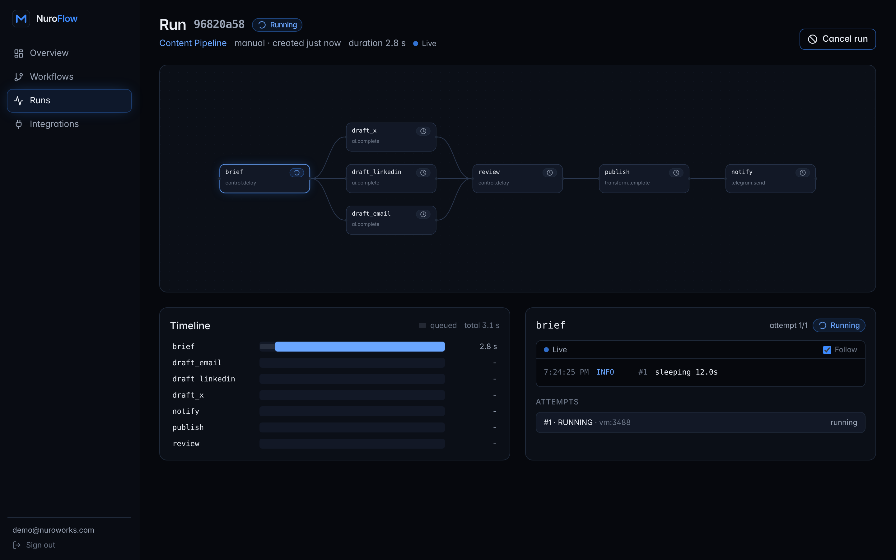

# Observability (Phase 6)

How you know NuroFlow is healthy, and find out why when it isn't. There are three signals,
each with a job:

| Signal | Answers | Where |
|---|---|---|
| **Metrics** | *Is something wrong, and how bad?* (rates, latencies, backlogs, spend) | Prometheus `/metrics` → Grafana + alert rules |
| **Logs** | *What exactly happened in this run?* | JSON lines with `run_id`, `task_run_id`, `request_id` |
| **Live views** | *What's happening right now?* | Dashboard, fed by SSE |

```bash
make api / make worker / make scheduler   # each exposes metrics
make observe        # Prometheus http://localhost:9090 + Grafana http://localhost:3000 (admin/admin)
make web            # dashboard http://localhost:5173
```

## Metrics

### Where they come from: three process models

| Process | Model | Endpoint |
|---|---|---|
| API | async, single process | `GET /metrics` on :8000, plus DB-derived gauges (cached 5s) |
| Worker | Celery **prefork**: N child processes | `:9101`, multiprocess mode (see below) |
| Scheduler | one sync loop | `:9102` |

**The prefork trap.** Celery forks children, and each child has its own copy of every counter.
A plain `start_http_server` in the parent would always report zero. Prometheus' multiprocess
mode has each process write samples to mmap files in `PROMETHEUS_MULTIPROC_DIR`, and the parent
serves the aggregate.

There's a second trap inside the first: `prometheus_client` chooses its storage **at import
time**. The first version of this phase set the directory after something had already imported
the library, so the worker endpoint was up but silently empty. The live Prometheus check caught
it. Now `observability/multiproc.py` (which imports nothing from `prometheus_client`) runs first,
and two regression tests guard it. One test forks a real child and asserts the parent aggregates
its counter.

**Why some gauges come from Postgres.** Queue depth, active runs and scheduler lag are *global*
facts that no single process knows, but Postgres does (ADR-0001). They're computed when `/metrics`
is scraped, with indexed queries and a 5s cache so several Prometheus replicas don't multiply the load.

### Catalogue

| Metric | Type | Labels | Use |
|---|---|---|---|
| `nuroflow_http_requests_total` | counter | method, route, status | traffic, error ratio |
| `nuroflow_http_request_duration_seconds` | histogram | method, route | latency SLOs (SSE streams excluded) |
| `nuroflow_task_attempts_total` | counter | operator, outcome | succeeded / retrying / failed |
| `nuroflow_task_duration_seconds` | histogram | operator | slow operators |
| `nuroflow_runs_finished_total` | counter | status | run failure rate |
| `nuroflow_llm_tokens_total` | counter | provider, model, kind | token burn |
| `nuroflow_llm_cost_usd_total` | counter | provider, model | spend (configured prices) |
| `nuroflow_notifications_total` | counter | channel_type, outcome | alert delivery health |
| `nuroflow_scheduler_tick_duration_seconds` | histogram | | scheduler health |
| `nuroflow_scheduler_last_tick_timestamp_seconds` | gauge | | "is it alive?" |
| `nuroflow_scheduler_dispatched_total`, `…_job_errors_total` | counter | job | per-job throughput and failures |
| `nuroflow_queue_depth` | gauge | queue | backlog per queue (0 when idle, never missing) |
| `nuroflow_oldest_queued_task_age_seconds` | gauge | | "workers can't keep up" |
| `nuroflow_active_runs` | gauge | status | in-flight work |
| `nuroflow_scheduler_lag_seconds` | gauge | | how late the most overdue cron is |
| `nuroflow_notifications_pending` | gauge | | outbox backlog |

**Counters are incremented only after the transaction commits**, so a rolled-back attempt never
inflates them.

**Label cardinality is a security and cost concern.** Every distinct label value is a new time
series. HTTP metrics use the **route template** (`/api/v1/runs/{run_id}`), never the raw path, and
unmatched paths collapse to `route="unmatched"`, so a scanner can't create millions of series.
FastAPI includes routers lazily, so the matched route only knows its own path. The middleware
rebuilds the full template from the URL prefix the route's regex didn't consume.

**`/metrics` is protected when deployed.** Metrics reveal traffic shape, queue sizes and spend.
`NUROFLOW_METRICS_TOKEN` is *required* in staging and production (the app refuses to start
without it, unless metrics are disabled) and is compared in constant time.

### Alerts (`deploy/prometheus/alerts.yml`)

Alerts are about symptoms users feel, each with a runbook hint. They're validated with
`promtool` and evaluated as healthy against live NuroFlow processes.

| Alert | Fires when |
|---|---|
| `NuroFlowSchedulerStalled` (critical) | no scheduler tick for 60s |
| `NuroFlowSchedulerLagging` | crons more than 2 min late for 5 min |
| `NuroFlowQueueBacklog` | oldest queued task waiting over 5 min |
| `NuroFlowHighRunFailureRate` | more than 20% of runs failing over 15 min |
| `NuroFlowApiErrors` (critical) | more than 5% of requests are 5xx |
| `NuroFlowNotificationBacklog` | more than 50 undelivered alerts for 10 min |
| `NuroFlowLLMSpendSpike` | more than $10 estimated spend in an hour (tune to your budget) |

### Grafana

`deploy/grafana/dashboards/nuroflow-overview.json` is provisioned automatically by `make observe`.
It has 15 panels: headline stats, runs and attempts by outcome, p95 task duration per operator,
queue depth, API p95 per route, the 5xx ratio, LLM tokens per model, notifications and scheduler
health. Every panel query was executed against a live Prometheus scraping the API, worker and
scheduler during development.

## Logs

Stdlib `logging` with two contextvars, applied by a **handler filter**, so they attach to every
record, including records from Celery, SQLAlchemy and httpx:

- `request_id`: set by the API middleware (and echoed as `X-Request-ID`).
- bound context via `bind_log_context(...)`: the worker binds `task_run_id`, `run_id`, `task_key`,
  `operator` and `attempt` around each execution, and the scheduler binds `job` around each job.

```json
{"ts":"2026-11-05T19:24:25.120Z","level":"info","logger":"nuroflow.engine.orchestrator",
 "msg":"run finished","request_id":"-","task_run_id":"01a1…","run_id":"01a1…",
 "task_key":"notify","operator":"telegram.send","attempt":1,"status":"succeeded"}
```

`grep run_id=01a1…` (text mode) or a Loki/Elastic query on `run_id` follows one run through the
API, scheduler and worker processes.

**Decision: no structlog.** The architecture originally planned structlog. In practice, every
library we run logs through stdlib, and the existing JSON formatter already emits structured
lines. structlog would add a second logging API with no difference in output. The contextvar
design gives the same bound-context behaviour with zero new dependencies.

**Operator logs** (the lines a task writes with `ctx.log`) are stored in `task_logs`, separate from
process logs. Since Phase 6 they're **flushed live**: the heartbeat thread persists new lines every
second while the operator runs, and the executor writes only the remainder at completion. A test
proves a line is visible mid-task and never duplicated.

## Live views (SSE)

| Stream | Events |
|---|---|
| `GET /runs/{id}/stream` | `snapshot` (run + task statuses, no payloads) on every change; `end` |
| `GET /task-runs/{id}/logs/stream` | `log` (with `id` = log id), `status`, `end` |

- **SSE rather than WebSockets:** data flows one way, reconnection and resume (`Last-Event-ID`) are
  built in, and it works through any HTTP proxy.
- **No pinned DB connections:** each stream authorizes with the request's session, releases it,
  then opens a short session per poll (1s). Hundreds of open dashboards cost tiny queries, not
  hundreds of held pool connections.
- **Bounded:** streams end after `NUROFLOW_SSE_MAX_STREAM_SECONDS` (30 min) and clients reconnect
  and resume. Heartbeat comments every 15s stop idle load balancers cutting the connection, and
  `X-Accel-Buffering: no` stops nginx buffering.
- The loop is a pure async generator with injectable `sleep`/`monotonic`, so heartbeats, max
  duration and disconnects are unit-tested in microseconds.

## Dashboard

React + TypeScript + Tailwind + TanStack Query + React Flow, in `frontend/` (see its README).



Design decisions:

- **SSE via `fetch()`, not `EventSource`.** EventSource can't send an Authorization header, and a
  JWT in the query string leaks into proxy and access logs.
- **Token storage.** The access token is in memory only. The refresh token is in sessionStorage
  (survives reload, not tab close, and is never auto-sent, so there's no CSRF). Refresh is
  single-flight, because the API revokes the session if a rotated refresh token is reused, so ten
  parallel 401s must cause exactly one refresh (tested). *Trade-off:* XSS could read sessionStorage.
  Phase 7 hardening serves the SPA and API from one origin with a strict CSP, and the next step
  would be an httpOnly refresh cookie.
- **Accessible charts.** Run outcomes use blue `#3d8bff` / red `#e5484d`, chosen after green/red
  *failed* a colour-vision check (deuteranopia ΔE 4.1) and this pair passed (worst ΔE 26.4). Every
  status also has an icon and a text label. The throughput chart has a legend, a hover tooltip and
  a table view.
- **Timeline origin = run creation.** Tasks are queued *before* a run counts as started. Measuring
  from `started_at` drew queue-wait bars at negative offsets, a bug found in the first screenshot
  review and now covered by a test.
- **`GET /stats/overview`** does the aggregation in Postgres (four indexed queries,
  `percentile_cont` for p50/p95) and zero-fills buckets server-side.
